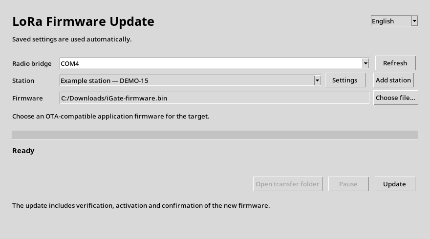

# Update a station over LoRa

[Français](LORA_OTA_OPERATOR_fr.md) · [English PDF](LORA_OTA_OPERATOR.pdf)

{width=85%}

## Regular use

1. Connect the USB radio bridge and open **LoRa Firmware Update**.
2. Select the **saved station** and the **firmware file**.
3. Click **Update**.

The application uses saved settings. It sends the file, verifies reception,
starts the new firmware and confirms its radio operation. Success is displayed
after boot confirmation.

## Once per station

Click **Add station**. Enter a name, the controller callsign, the station's
**Callsign-SSID** and its existing secret. Set the normal and temporary radio
profiles. If needed, enter the relay and the shared route secret. Click **Save**.

These values must match those already installed on the devices. Bridge,
target and optional relay must have compatible firmware. The application does
not perform their initial installation or provisioning. Secrets are masked;
counters and logs are managed automatically.

## Interruption

**Pause** retains durably received pages. Allow up to one minute for the normal
radio profile to return, then restart with the **same firmware**. Allow activation
and confirmation to finish once they have started. Open the transfer folder
for details if a run fails.

**Prototype status:** EN/FR interface connected to the engine; host tests use
a simulated engine, with no board. This client currently supports the TTGO
LoRa32 V2.1 / SX1278. A standalone Windows distribution still needs to be built
and tested. The source launcher `LoRaFirmwareUpdate.pyw` requires Python,
Tkinter and PySerial to be installed.
