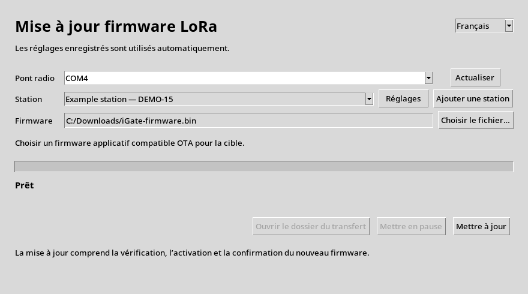

# Mettre à jour une station par LoRa

[English](LORA_OTA_OPERATOR.md) · [PDF français](LORA_OTA_OPERATOR_fr.pdf)

{width=85%}

## Usage courant

1. Brancher le pont radio USB et ouvrir **LoRa Firmware Update**.
2. Sélectionner la **station enregistrée** et le **fichier firmware**.
3. Cliquer sur **Mettre à jour**.

L’application utilise les réglages enregistrés. Elle envoie le fichier,
vérifie sa réception, démarre le nouveau firmware et confirme son fonctionnement
radio. La réussite est affichée après confirmation du démarrage.

## Une seule fois par station

Cliquer sur **Ajouter une station**. Saisir son nom, l’indicatif du contrôleur,
le **Callsign-SSID** de la station et sa clé existante. Choisir les profils radio
habituel et temporaire. Si nécessaire, renseigner le relais et la clé commune
de la route. Cliquer sur **Enregistrer**.

Ces valeurs doivent correspondre à celles déjà installées sur les appareils.
Le pont, la cible et le relais éventuel doivent avoir les firmwares compatibles.
L’interface ne réalise pas leur installation initiale ni leur provisionnement.
Les clés sont masquées ; les compteurs et journaux sont gérés automatiquement.

## Interruption

**Mettre en pause** conserve les pages reçues durablement. Attendre le retour
au profil radio habituel, au plus une minute, puis relancer avec le **même
firmware**. Pendant l’activation et la confirmation, laisser l’opération finir.
Le dossier du transfert contient les détails en cas d’échec.

**État du prototype :** interface EN/FR et moteur raccordés ; essais sur
ordinateur avec moteur simulé, sans carte. Matériel actuellement pris en
charge par ce client : TTGO LoRa32 V2.1 / SX1278. La distribution Windows
sans installation de Python reste à produire et tester. Le lanceur source
`LoRaFirmwareUpdate.pyw` nécessite Python, Tkinter et PySerial installés.
